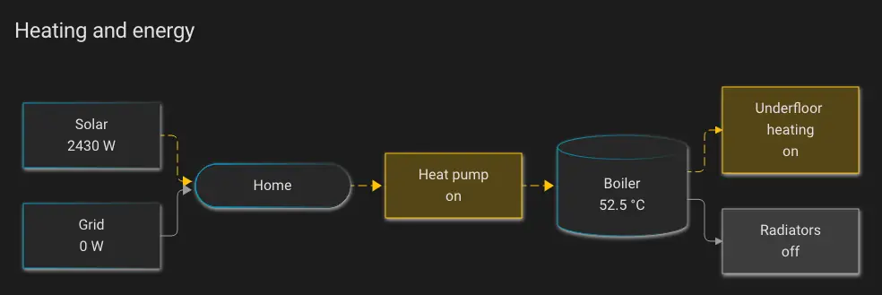

# Mermaid Card

[](https://hacs.xyz/docs/faq/custom_repositories/)

[](https://github.com/timmaurice/lovelace-mermaid-card/releases)
[](https://github.com/timmaurice/lovelace-mermaid-card/commits/main)
[](https://github.com/timmaurice/lovelace-mermaid-card)


A Home Assistant Lovelace card that renders [Mermaid](https://mermaid.js.org/) diagrams — flowcharts, state, sequence, class, Gantt and more — styled with your Home Assistant theme and kept live with your entity states.



## Features

### Live diagrams

- **Live values:** the diagram source is a Home Assistant template, so labels can show states — or the whole diagram can be [built from entities](#diagrams-built-from-entities).
- **Bound nodes:** map a node to an entity and it is coloured by that entity's state; tapping it opens more-info, or runs the action you choose.
- **Live flows:** map an edge to an entity and it animates in the entity's colour while that entity is active, at the speed the diagram gives it.
- **Every diagram type:** flowchart, sequence, state, class, entity relationship, Gantt, pie, mind map, timeline, journey and the rest of Mermaid, in your theme's colours and dark mode.
- **Automations as diagrams:** give the card an automation instead of a diagram, and it draws its triggers, conditions and actions with the path of the last run highlighted.
- **Wide diagrams:** a diagram shrinks to fit the card and opens at full size in a dialog when it does not fit.

### Visual editor

- Pick the diagram type and start from an example; pasted Mermaid with a header line is understood.
- Bind nodes and edges from a list read from your diagram, with the matching entity suggested.
- Add an entity as a new node, with its name and live state, in one step.
- Mermaid's parse errors show right at the diagram field.

### AI friendly

Any Mermaid an assistant writes can go straight into `content` (or into a sensor attribute the template reads). Point your assistant at [`llms.txt`](llms.txt): the config, how bindings behave, template patterns, the traps, and a tested example for every diagram type.

## Localization

The editor is available in English and German. Contributions of further languages are welcome: add a file to `src/translation/` and import it in `src/localize.ts`.

## Installation

### HACS (Custom repository)

Mermaid Card is not in the default HACS catalog yet. Add it as a custom repository (type **Dashboard**); the button opens HACS with the repository filled in:

<a href="https://my.home-assistant.io/redirect/hacs_repository/?owner=timmaurice&repository=lovelace-mermaid-card&category=plugin" target="_blank" rel="noreferrer noopener"></a>

Install **Mermaid Card** and reload the browser.

<details>
<summary>Manual Installation</summary>

1.  Download the `mermaid-card.js` file from the latest release.
2.  Place it in your `config/www` directory.
3.  Add the resource reference to your Lovelace configuration under `Settings` -> `Dashboards` -> `...` -> `Resources`.
    - URL: `/local/mermaid-card.js`
    - Resource Type: `JavaScript Module`

You can now add the card to your dashboard.

</details>

Mermaid itself is bundled into the card (about 1.6 MB compressed) but only run when a diagram is shown.

## Configuration

The card has a visual editor. Pick the **Diagram type** from a dropdown; switching it on an empty diagram or an untouched example fills in an example of the new type. Mermaid pasted with its first line (`flowchart LR`, …) is understood: the editor moves the type and direction into their fields. A first line that says more, like `pie showData`, stays in the diagram. Under **Bound nodes** you pick a node from a list the editor reads from your diagram, and an entity for it. When exactly one entity's friendly name matches the node's text, or its object id the node id, it is filled in for you. In a flowchart, **Add an entity as a node** appends a node with the entity's name and state and binds it in one step.

| Option         | Type   | Required | Description                                                                                                                                                                                                       |
| -------------- | ------ | -------- | ----------------------------------------------------------------------------------------------------------------------------------------------------------------------------------------------------------------- |
| `content`      | string | yes      | The diagram. May contain templates (`{{ states('sensor.x') }}`). A first line naming the type (`flowchart LR`, `sequenceDiagram`, …) is optional.                                                                 |
| `diagram_type` | string | no       | Mermaid diagram type when `content` has no first line naming one: `flowchart` (default), `sequenceDiagram`, `stateDiagram-v2`, `pie`, …                                                                           |
| `title`        | string | no       | Card header.                                                                                                                                                                                                      |
| `entities`     | map    | no       | Node or edge id → entity id, or a mapping with `entity`, `active_when`, `tap_action`, `hold_action`, an edge's `speed` and `max`. For flowcharts, state, class diagrams, Gantt, kanban, mind maps, pies, sankeys. |
| `direction`    | string | no       | A flowchart's direction: `TB` (top to bottom, the default), `BT`, `LR` or `RL`. Overrides a direction in the content's first line.                                                                                |
| `scale`        | number | no       | Size in percent of the diagram's natural size, e.g. `70`. Default `100` fits the diagram to the card.                                                                                                             |

```yaml
type: custom:mermaid-card
title: Heating
direction: LR
content: |
  HP[Heat pump] --> BOIL[("Boiler<br>{{ states('sensor.boiler_temperature') }} °C")]
  BOIL --> LR["Living room<br>{{ state_attr('climate.living_room', 'current_temperature') }} °C"]
entities:
  HP: switch.heat_pump
  LR: climate.living_room
```

### Bound nodes and edges

A bound node takes its entity's state colour. A tap opens more-info unless the binding sets a `tap_action`; a long press runs its `hold_action`. Both take Home Assistant's usual [actions](https://www.home-assistant.io/dashboards/actions/) (`toggle`, `navigate`, `perform-action`, …).

What the key names depends on the diagram type:

| Type                            | Key               | Example                           |
| ------------------------------- | ----------------- | --------------------------------- |
| Flowchart, state, class diagram | node id           | `HP` in `HP[Heat pump]`           |
| Gantt                           | task id           | `wash` in `Wash :wash, 10:00, 2h` |
| Kanban                          | item or column id | `card1` in `card1[Clean filter]`  |
| Mind map                        | label             | `Kitchen` in `k[Kitchen]`         |
| Pie                             | slice label       | `Washer` in `"Washer" : 30`       |
| Sankey                          | node name         | `Solar` in `Solar,House,5`        |

Mermaid keeps no ids for mind map nodes, pie slices or sankey nodes, so these are bound by the text they show (a line break counts as a space). A label written by a template must be written the same way in `entities`. Pie slices and sankey nodes keep their chart colours and only take the tap and hold; a pie binding also makes its legend entry tappable.

```yaml
type: custom:mermaid-card
content: |
  mindmap
  root((Home))
    Kitchen
      Ceiling light
    Hall
entities:
  Ceiling light:
    entity: light.kitchen_ceiling
    tap_action:
      action: toggle
  Hall:
    entity: light.hall
    tap_action:
      action: navigate
      navigation_path: /home/hall
```

An edge is bound by its id. Name it with Mermaid's `@` syntax (`HP e1@--> BOIL`) or use the id the editor lists. While its entity is on, open, heating or a number other than zero, the edge animates in the entity's colour. Its arrowhead takes that colour too. How the edge moves is up to the diagram: Mermaid's [edge animations](https://mermaid.js.org/syntax/flowchart.html#turning-an-animation-on) (`e1@{ animation: slow }`, or a `classDef` with its own `animation`) are kept, and the entity only turns them on and off. Without one, a bound edge moves fast.

```yaml
type: custom:mermaid-card
content: |
  PUMP[Heat pump] flow@--> BOIL[Boiler]
  flow@{ animation: slow }
entities:
  PUMP:
    entity: switch.heat_pump
    hold_action:
      action: toggle
  flow: sensor.heat_pump_power
```

Several nodes can share one entity with `active_when`: a node then counts as active only while the entity has that state, or one of a list of states, and shows the inactive colour otherwise. A robot vacuum's state diagram lights up the state it is in:

```yaml
type: custom:mermaid-card
diagram_type: stateDiagram-v2
content: |
  [*] --> Docked
  Docked --> Cleaning
  Cleaning --> Docked
entities:
  Docked:
    entity: input_select.robot_vacuum
    active_when: [Docked, Charging]
  Cleaning:
    entity: input_select.robot_vacuum
    active_when: Cleaning
```

On a bound edge, `active_when` decides when it moves. Numbers go in quotes (`active_when: "3"`).

With `speed: auto` the edge moves faster the higher its entity's value, like an energy-flow card: from Mermaid's slow speed near zero to four times its fast speed at `max` (default `10000`). The value counts on a log scale, so 50 W still visibly moves next to 5 kW. A negative value (export to the grid) moves just as fast, in the other direction. The edge keeps its dash pattern, and still only moves while the value is not zero.

```yaml
entities:
  pv:
    entity: sensor.solar_power
    speed: auto
    max: 8000 # W at full speed; for a sensor in kW, e.g. max: 8
```

A diagram shrinks to fit the card down to three quarters of its natural size; beyond that it scrolls sideways, so the text stays readable. For a narrow card, `direction: TD` usually fits better than a wide `LR` flowchart. When a diagram does not fit, a button in the card's corner opens it larger in a dialog, where bound nodes still work. There, pinch or the mouse wheel zooms, dragging pans, and a double tap or double click fits the diagram again.

### Icons

Mermaid's [icon shapes](https://mermaid.js.org/syntax/flowchart.html#icon-shape) and the icons of an `architecture-beta` diagram take Home Assistant's icon names: `mdi:` (all of Material Design Icons), `hass:` and the prefixes of custom icon integrations. The card fetches just the icons a diagram uses from Home Assistant, so no icon set is bundled. An icon Home Assistant does not know shows as a question mark.

```yaml
type: custom:mermaid-card
direction: LR
content: |
  HP@{ icon: "mdi:heat-pump", label: "Heat pump" } --> BOIL@{ icon: "mdi:water-boiler", label: "Boiler" }
```

### Diagrams built from entities

The whole diagram can come from a template. This Gantt chart shows every switch that is on, from the moment it was switched on until now; it grows each minute and shows a marker when nothing runs:

```yaml
type: custom:mermaid-card
title: Running now
diagram_type: gantt
content: |
  dateFormat HH:mm
  axisFormat %H:%M
  section Running
  
  {{ e.name | replace(':', ' ') }} :{{ as_local(e.last_changed).strftime('%H:%M') }}, {{ [1, ((now() - e.last_changed).total_seconds() / 60) | round(0, 'ceil') | int] | max }}m
  
  Nothing running :milestone, {{ now().strftime('%H:%M') }}, 0m
  
```

Narrow the loop to what you want to see: `expand(label_entities('laundry'))` or `expand('switch.washer', 'switch.dryer')` in place of `states.switch`. A colon in a task name ends it in Mermaid, hence the `replace`.

Home Assistant trims the rendered template, so its first line loses any indentation. Where indentation means structure (mind map, kanban), indent relative to that first line: put the top level at the start of the line.

Mermaid's hexagon shape `A{{text}}` collides with template syntax. Wrap such a diagram in `…` or write the braces as `{{ '{{' }}` and `{{ '}}' }}`.

### An automation and its last run

Instead of `content`, give the card an automation entity. It draws the automation as a flowchart, triggers at the top, then conditions and actions, with `choose` and `if` as branches, and highlights the path of its last run: the steps that ran get an amber border, a step that failed a red one, and the edges along the path move. A tap on the top node opens the automation's more-info, where Home Assistant shows its traces and runs it. The card redraws after every run.

```yaml
type: custom:mermaid-card
title: Hall light
automation: automation.hall_light
```

The card reads the automation's config and latest trace over Home Assistant's websocket, which needs an admin user. Only automations with an `id` (those made in the UI, or with an `id` in YAML) keep traces; others are drawn without a run. `direction` and `scale` work as usual. A `parallel` block or a nested `sequence` shows as one step.

## Development

<details>
<summary>To contribute to the development, you'll need to set up a build environment.</summary>

1.  **Clone the repository:**

    ```bash
    git clone https://github.com/timmaurice/lovelace-mermaid-card.git
    cd lovelace-mermaid-card
    ```

2.  **Install dependencies:**

    ```bash
    npm install
    ```

3.  **Build the card** into `dist/mermaid-card.js`, or keep it rebuilding with `npm run watch`:

    ```bash
    npm run build
    ```

Run the unit tests with `npm test` (or keep them running with `npm run test:watch`) and the type check with `npm run typecheck`.

### Local Testing with Docker

`docker compose up -d` starts Home Assistant at [http://localhost:8137](http://localhost:8137) with `dist/` mounted as `/config/www`, so the card is served as `/local/mermaid-card.js`. Its configuration persists in `test/ha-config`.

### End-to-end tests

The Playwright suite runs from a fresh clone with one command (Docker and Node required):

```bash
npm ci && npx playwright install chromium && npm run test:e2e
```

Global setup builds the card, starts the compose Home Assistant, onboards it through the API (user `admin` / `password`) and registers the bundle as a Lovelace resource. CI runs the same thing in `.github/workflows/e2e.yml`.

</details>

---

For further assistance or to [report issues](https://github.com/timmaurice/lovelace-mermaid-card/issues), please visit the [GitHub repository](https://github.com/timmaurice/lovelace-mermaid-card).

The icon uses the [Mermaid](https://github.com/mermaid-js/mermaid) logo, MIT licensed, © Knut Sveidqvist.

## ☕ Support My Work

[](https://www.buymeacoffee.com/timmaurice)
